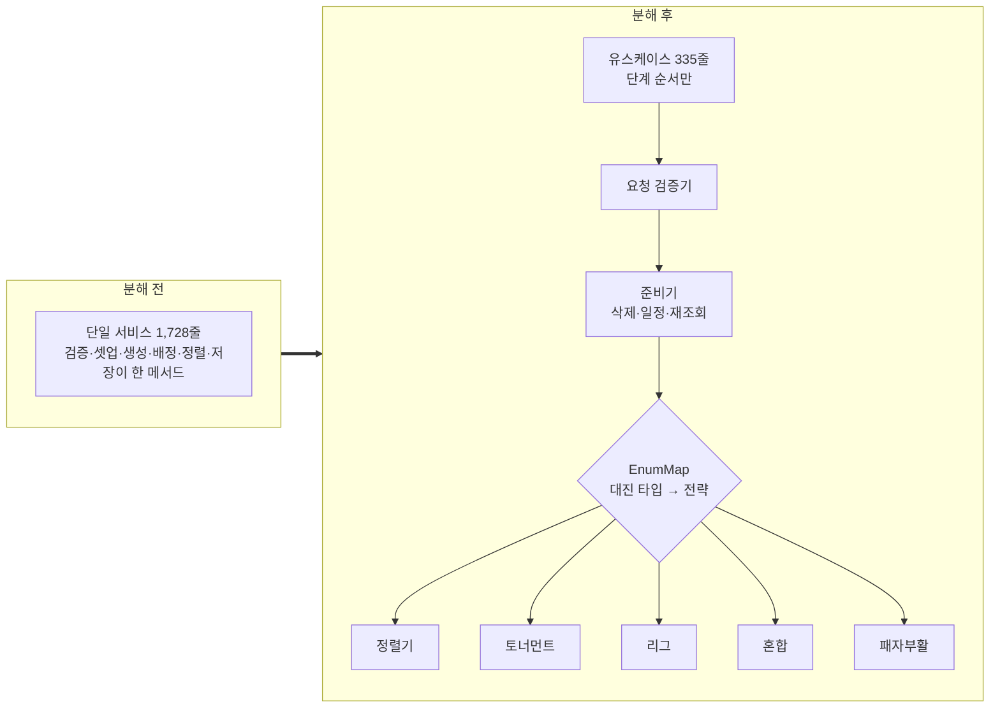

# 2026-06-15

**요약**: 대회 전체 매치를 생성하는 1,728줄짜리 단일 서비스를 유스케이스 335줄 + 전략 4종 + 협력자 3종으로 분해했다. 골든 마스터 스냅샷 diff 0으로 행동 보존을 증명했고, 중간에 "테스트가 green인데 실은 안 돌고 있던" 사고를 한 번 겪었다.

## 배경과 제약
확정 대진표로 대회의 매치를 전부 만들고 경기장·조·순서를 확정하는 작업이 메서드 하나에 몰려 있었다. 종목 분기와 대진 타입(토너먼트·리그·혼합·패자부활) 분기가 뒤엉켜 새 대진 타입을 넣으려면 그 메서드를 읽어야 했다. 합격선은 하나. 외부 동작·컨트롤러 시그니처 불변, 골든 마스터 통합 테스트 green.

## 선택
먼저 골든 마스터 안전망을 깔았다(별도 PR, 9개 시나리오). 그 다음 5단계로 쪼갰고 매 커밋마다 스냅샷 diff 0을 확인하고서야 커밋했다.

- 전략은 EnumMap으로 디스패치하고 **부팅 시 모든 대진 타입에 전략이 등록됐는지 검증**한다. 누락이 런타임 500이 아니라 기동 실패로 드러나게.
- 트랜잭션은 유스케이스 진입점 하나. 전량 삭제 후 재생성이라 all-or-nothing이어야 하고, 협력자·전략은 새 트랜잭션을 열면 안 된다.
- 배정 루프 22줄은 따로 빼지 않고 본체에 남겼다. 한 흐름을 잘게 쪼개 파일 점프만 늘리는 건 분해가 아니다. 분리 기준은 "닫힌 책임 + 디테일 부피".
- 일반화는 두 번째 사용처가 나올 때(JIT). 상장 전략은 안 만들었다.

## 막혔던 것
테스트 파일을 `git mv`로 리네임한 뒤 Gradle 증분 컴파일이 테스트 .class 생성을 빠뜨렸다. `--tests` 필터를 여러 개 걸어 둔 상태라 "No tests found" 없이 골든 마스터만 조용히 빠진 채 BUILD SUCCESSFUL이 떴다. 한 단계 커밋 전 검증이 이 상태로 지나갔다. 테스트 빌드 산출물을 지우고 강제 재컴파일한 뒤 push된 HEAD에서 전체 55개 fail 0을 소급 확인해 코드는 무사했지만, "green"을 믿은 게 틀렸다. 그 뒤로는 BUILD SUCCESSFUL이 아니라 **실행된 테스트 개수**를 본다. 테스트 리포트의 이름은 DisplayName이라 메서드명 grep으로 실행 여부를 판단하면 안 된다는 것도 이때 알았다.

## 결과와 대가
- 1,728 → 335줄(-81%). 커버리지 유스케이스 95%, 검증기 100%, 정렬기 84%(분기 278개).
- 대가: 파일이 10개 이상 늘었다. 패자부활 전략의 참가자 타입 하드코딩은 잠재 버그로 알고도 이번엔 "이동만"이라 그대로 옮겼다(별도 티켓). 리팩토링 중엔 잠재 NPE도 고치지 않는다. 자를 깎으면서 측정하면 측정이 무효가 된다.

태그: #refactoring #strategy-pattern #golden-master #behavior-preservation #gradle
