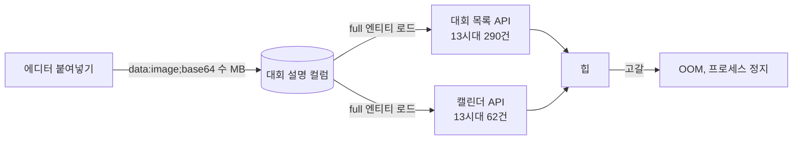

# 2026-07-20

**요약**: 대회 설명 에디터에 붙여넣은 이미지가 base64로 본문에 인라인 저장되다가 운영 서버가 OOM으로 죽었다. 로그 아카이브 기준 13:43:47 마지막 요청 → 22:30:04 재개, 그 사이 8시간 47분이 비어 있다. 저장 차단으로 재발을 막았고, 이미 들어간 데이터는 정리했다.

## 배경과 제약
5월에 대회 설명 에디터에 이미지 업로드가 들어왔다. 업로드 경로는 S3 presigned PUT이 따로 있었는데, 에디터에 이미지를 **붙여넣기**하면 `data:…;base64,…` 형태로 본문에 그대로 박혔다. 몇 MB짜리 문자열이 대회 행의 설명 컬럼에 들어간다. 그리고 대회 목록·캘린더 조회는 full 엔티티를 로드한다.

## 막혔던 것
그날의 운영 로그를 S3 아카이브에서 꺼내 보면 이렇다.
- 13:00~13:43 요청 3,228건, 전날 같은 시간대 2,409건보다 34% 많다. 그중 대회 목록 290건, 캘린더 62건.
- 응답 시간은 끝까지 멀쩡했다. 분당 평균 4~9ms, 최대 409ms 한 번. **느려지다 죽은 게 아니라 멀쩡하다 죽었다.** 힙이 임계까지는 GC가 버티고 그 다음은 한 번에 무너지는 패턴이다.
- 13:43:47 마지막 요청 로그. 그 뒤 로그가 없다. OOM 자체는 애플리케이션 로그에 안 남았다. JVM이 죽으면 로거도 같이 죽는다.
- 14:53 저장 차단 수정이 포함된 배포가 돌았고 헬스체크는 통과했다. 그런데도 로그는 22:30:04에야 다시 시작된다.

마지막 항목이 교훈이다. 저장을 막는 수정은 **새로 들어오는 것**만 막는다. 이미 DB에 들어간 수 MB 설명은 그대로라 목록 조회가 또 힙을 먹는다. 코드 수정만으로는 복구가 안 되고 데이터 정리가 같이 가야 했다. [확인] 22:30까지 어떤 순서로 데이터를 정리하고 재기동했는지는 로그에 없다.

## 선택
- 대회 생성·수정 시 설명에 `base64` 토큰이 들어 있으면 저장을 거부한다. 붙여넣기 이미지는 항상 이 형태라 토큰 하나로 판별이 된다. 전용 에러 코드로 프론트가 "이미지는 업로드 버튼으로"를 안내하게.
- 대용량은 기존 S3 presigned PUT 경로로.

## 결과와 대가
- 지금 운영 덤프를 보면 설명에 base64가 든 대회 0건, 가장 큰 설명이 0.01MB. 정리됐다.
- 남은 구조 문제: 목록·캘린더가 full 엔티티를 로드하는 건 그대로다. 설명이 아니라도 큰 컬럼이 또 생기면 같은 자리에서 터진다. 목록은 projection으로 가야 한다(별건).
- 교훈: 지표에 전조가 없는 장애가 있다. 응답 시간은 OOM을 예고하지 않는다. 힙 사용률 알림이 있어야 했고, 이게 두 달 뒤 관측성 작업에서 힙·GC 패널과 경보를 먼저 만든 이유다.

태그: #incident #oom #base64 #editor #data-cleanup #observability
