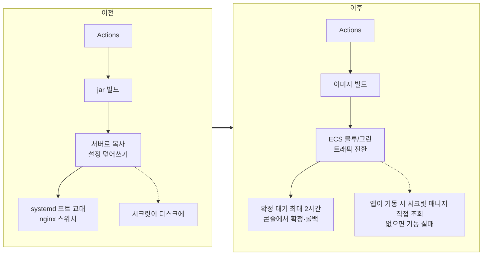

# 2026-09-08

**요약**: 운영을 가상머신 한 대 + jar에서 ECS Fargate 블루/그린으로 옮기고, DB와 캐시도 AWS 관리형으로 이전했다. 32개 커밋짜리 PR을 머지한 날 롤백 경로를 일부러 깨뜨려 보다가 틀린 가설 두 개를 거쳐 버그 두 건을 잡았다. 컷오버는 다음 날.

## 배경과 제약
운영은 Lightsail 가상머신에 systemd + jar, 설정 30개가 태스크 환경변수에 묶여 있어 Hikari 풀 크기 같은 평범한 설정도 인프라 파일에서 관리했다. 7월에 멀티스테이지 Dockerfile(비루트, 레이어 캐시)과 stdout 로깅으로 컨테이너 준비를 해 뒀고, 7월 말 DB를 RDS로 옮겼다. 이번에 실행 환경·배포 파이프라인·시크릿·캐시를 한 번에 바꿨다. 조건은 하나, 운영 ALB 리스너 규칙은 건드리지 않아 트래픽에 영향이 없을 것. 컷오버는 별도.

## 선택

- **Fargate 블루/그린 + 확정 대기.** 트래픽을 넘긴 뒤 최대 2시간 구버전을 살려 두고, 확정·롤백은 GitHub 워크플로 대신 ECS 콘솔 버튼으로. 콘솔이 이미 그 상태를 그대로 보여 주는데 워크플로를 하나 더 두면 상태가 두 곳이 된다.
- **설정은 git으로, 시크릿은 앱이 직접.** 태스크 정의의 environment 30 → 5, secrets 6 → 10. 프로파일 설정은 클래스패스에 커밋하고 시크릿은 `${…}`만 선언. 앱이 기동 시 시크릿 매니저에서 읽고, 없으면 조용히 깨진 채 뜨는 대신 기동을 실패시킨다. 배포·PR 양쪽에 "시크릿 키에 리터럴이 오면 빌드 실패" 가드.
- **운영 배포 소스는 main으로 고정.** 브랜치 선택 입력을 무의미하게 만들었다.
- **dev/staging은 compose 3컨테이너**(api·mysql·valkey). 배포 전 테스트 게이트, 실패 시 이전 이미지 롤백, 시크릿은 러너 디스크를 거치지 않고 기동 스텝 프로세스 환경에만.
- **다중 인스턴스 대응**(Redis 중계·캐시 무효화 전파·ShedLock)은 같이 들어가되 운영은 플래그 off로 시작. 자세한 건 10-01 일지.
- 빌드는 3레이어(Gradle 배포판/의존성/소스)로 나눠 39.0초 → 20.4초. 베이스 이미지는 태그 대신 다이제스트 고정.

## 막혔던 것 — 롤백 검증에서 틀린 가설 두 개
정상 경로는 dev·staging 배포로 통과했지만 롤백은 성공한 배포로는 절대 안 돌아본다. 일부러 깨뜨렸다. 임시 브랜치에서 시크릿 import를 존재하지 않는 키로 바꿔 기동을 실패시키는 방식. Flyway보다 앞에서 죽어 DB 부작용이 없다.

**첫 번째.** 롤백 컨테이너가 `address already in use`로 못 떴다. "크래시 루프 컨테이너의 재시작 경합"이라고 단정하고 `compose stop`을 넣어 다시 돌렸는데 같은 오류. 실제 점유자는 **구 systemd 서비스**였다. 유닛은 disabled인데 active(running)이었고, 시작 시각이 롤백 검증의 헬스 실패 18초 전. 검증으로 dev가 비는 순간에 뭔가가 구 서비스를 띄웠다. 누가 띄웠는지는 끝내 특정 못 했다. 결정적 단서는 "롤백할 이전 이미지가 없습니다"였다. compose가 관리하는 컨테이너가 없는데 dev는 200을 주고 있었다. 서빙 주체가 compose 밖에 있었던 것이다. 파생 사고로 그 1시간 21분 동안 쓰기 11건이 구 호스트 DB로 갔다. 이름만 같은 다른 DB였다. 컨테이너 DB를 정본으로 되돌리고 작업자에게 알렸다.

**두 번째.** 구 jar를 세우고 컨테이너를 올렸더니 시크릿 매니저 접속이 `UnknownHostException`. 같은 네트워크의 busybox로는 DNS가 됐으니 "일시적 DNS 실패"로 봤다. 틀렸다. `docker inspect`에 networks가 비어 있었다. 네트워크 설정 단계에서 실패한 배포가 컨테이너를 Created 상태로 남겼고, plain `up -d`는 이미지·설정 해시가 같으면 재생성하지 않고 그 컨테이너를 그냥 시작한다. 내장 DNS에 닿을 수 없는 반쪽 컨테이너였다. 수정은 `up -d` 앞에서 `stop` 대신 **`rm -sf`**. 반쯤 만들어진 컨테이너를 되살릴 수 없게 한다.

하나 더. 빌드가 이동 태그를 새 이미지로 옮기는데 이를 되돌리는 `docker tag`가 기동 **뒤**에 있어서 롤백이 실패하면 실행되지 않았다. 앞으로 옮겼다.

## 결과와 대가
- 다음 날 컷오버. 운영 트래픽이 ECS로 갔고, 이후 2주 안에 ElastiCache 생성·운영 Redis 플래그 on·Hikari 상주 커넥션 30 → 5(오토스케일 최대 4대 × 블루/그린 2배 = 240이 RDS 한도 턱밑이라서)·태스크 수 변동 슬랙 알림이 뒤따랐다.
- 대가: 블루/그린 확정 대기 2시간 동안 구·신 버전이 같은 DB를 본다. 컬럼 DROP·RENAME·NOT NULL 추가 금지, expand-and-contract 필수. 스케일아웃하지 않아도 배포 때마다 이미 멀티 인스턴스라는 뜻이고, 이게 10-01의 검증으로 이어진다.
- 교훈: 두 번 다 "가장 흔한 원인"을 먼저 집었다가 틀렸다. 둘 다 결정적 단서는 에러 메시지가 아니라 **모순**이었다. 컨테이너가 없는데 200이 온다, DNS가 되는데 안 된다. 모순이 보이면 가설을 버려야 한다.

태그: #ecs #fargate #blue-green #deployment #rollback #secrets #incident #containers
