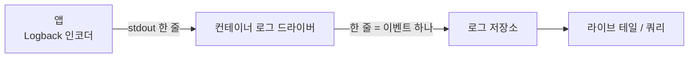
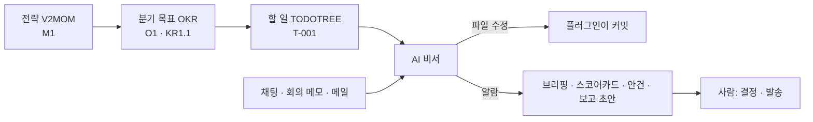
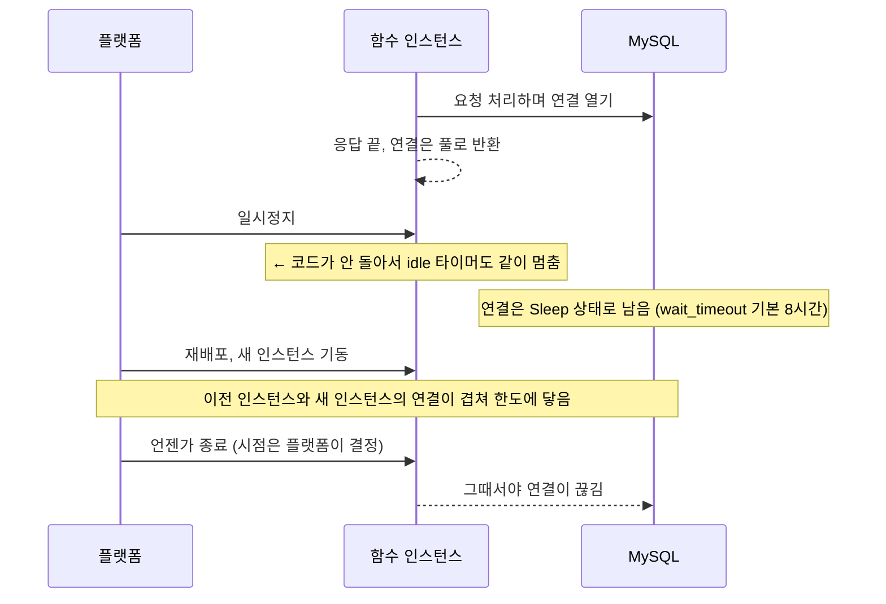

# 2026-10-13

**요약**: 배포 환경 JSON 로그의 필드 순서를 라이브 테일에서 읽히게 바꾸면서, "형태만 바뀌고 데이터는 그대로"를 실제 로그로 증명하는 검증 절차를 만들었다. 운영 로그를 이벤트로 되살려 이전·새 인코더에 같이 넣는 재현 비교로 약 1만 4천 줄이 값 동일함을 확인했고, 그 과정에서 첫 구현이 Spring 로그의 `tags` 필드를 빠뜨린 걸 잡았다.

## 배경과 제약
로그는 Logback + logstash-logback-encoder 의 `LogstashEncoder` 로 한 줄 JSON 을 stdout 에 쓰고, 컨테이너 로그 드라이버가 CloudWatch 로 보낸다. 줄 앞이 `@timestamp`·`@version`·`message`·`logger_name`·`thread_name` 으로 채워져 레벨과 경로가 뒤에 묻혔다. 요청은 `[api]:[level]:[message]` 평문이었지만, 평문은 스택트레이스가 줄마다 별도 이벤트로 쪼개지고 Logs Insights 의 자동 필드 인식을 잃어서 JSON 을 유지하고 **순서만** 바꾸기로 했다. 필드 이름은 기존 쿼리 때문에 건드리지 않는다.

## 흐름
로그가 화면에 닿는 길. 인코더가 쓴 문자열이 가공 없이 그대로 간다는 게 검증의 전제다.



검증은 네 단계로 했다. 앞 단계가 다음 단계의 전제를 만든다.

```pseudo
1. 로컬 실측:
   # 프로필은 local 유지 (아니면 알림이 실제로 나감)
   설정 파일만 바꿔 끼워 배포용 JSON 블록을 켬
   정상·에러 10종 요청 → 출력 순서 확인

2. 배포 설정 확인 (읽기 전용 계정):
   실제 등록된 태스크 정의의 프로필·환경변수·실행 인자 확인
   # ← 레포의 json 이 아니라 지금 돌고 있는 정의를 봐야 함
   빠지는 필드를 쓰는 메트릭 필터·구독·저장 쿼리·알람 조회

3. 실제 로그 재현 비교:
   for 줄 in 세 환경의 실제 로그 (ERROR·WARN·tags·stack_trace 따로 더 모음):
       이벤트 = 되살리기(로거, 레벨, 메시지, 스레드, 나노초 시각, MDC, 마커)
       이전 = 이전 인코더(이벤트)
       # ← 복원 정확도: 여기가 같아야 아래 비교를 믿을 수 있음
       assert 이전 == 줄
       새 = 새 인코더(이벤트)
       assert 새 == 이전 - {@version, level_value}

4. 되살릴 수 없는 것 따로:
   같은 예외(단일·원인 체인·suppressed·깊은 스택)를 두 인코더에 → stack_trace 문자열 비교
```

인코더 설정은 `LogstashEncoder` 를 `LoggingEventCompositeJsonEncoder` 로 바꾸고 provider 를 원하는 순서로 나열했다. `level` → MDC 의 도메인·메서드·경로 → `message` → 나머지 MDC → 스택 → 로거·스레드 → `@timestamp` 순서다.

## 막혔던 것
- **MDC 를 한 묶음으로 넣으면 순서가 안 지켜졌다.** `includeMdcKeyName` 을 domain·httpMethod·path 순으로 적었는데 path → httpMethod → domain 으로 찍혔다. Logback MDC 가 HashMap 이라 키 필터는 고를 키만 거르고 순서는 해시 순서를 따른다. 키마다 `<mdc>` provider 를 따로 둬서 고정했다.
- **"빠지는 건 두 필드뿐"이 틀렸다 — 틀렸던 가설.** 로컬에서 이전·새 출력의 키 목록을 비교해 `@version`·`level_value` 외 누락 없음으로 결론냈다. 비교에 쓴 이벤트에 마커가 붙은 로그가 없었다. dev 실제 로그로 배포 후 모습을 예상해 보다가 `"tags":["COMMONS-LOGGING"]`(Spring 이 commons-logging 경유로 남기는 로그의 마커)가 새 설정에서 사라지는 걸 봤다. dev 에선 182줄 중 100줄에 붙어 있었다. `LogstashEncoder` 가 기본으로 켜 두던 tags·Logstash marker·key-value·StructuredArguments provider 를 넣어 복원했다. 키 목록 비교가 아니라 **실제 로그 전체를 재현 비교**하는 3단계를 만든 계기다.
- **IDE 실행 인자가 안 먹었다.** Program arguments 에 넣은 `--logging.config` 가 실제 프로세스 인자에 없었다. `ps` 로 확인한 뒤 프로필별 properties 에 임시 한 줄을 넣는 쪽으로 바꿨고, 확인 후 지웠다.
- **충돌 검사 오탐.** `git diff --name-only HEAD..origin/develop` 에 내 파일이 잡혀 develop 도 같은 파일을 바꾼 줄 알았다. 그 diff 는 내 변경 자체를 보여준 것이었다. `git log HEAD..origin/develop -- <파일>` 와 `git merge-tree --write-tree` 로 다시 봐야 했다.

## 결과와 대가
| 환경 | 줄 | 이전 인코더 = 실제 로그 | 새 인코더 값 동일 |
|---|---|---|---|
| dev | 182 | 182 | 182 |
| staging | 1,675 | 1,675 | 1,675 |
| prod | 12,100 | 12,100 | 12,100 |

필드별 값 차이 0건, `stack_trace` 4/4 글자 단위 동일. 문자열로는 다른 줄이 1,477줄 있었는데 전부 MDC 키 사이 순서 차이(해시 순서)였고 값은 같았다. 대가는 `@version`·`level_value` 두 필드가 빠지는 것뿐이고, 둘을 쓰는 필터·쿼리·알람이 없는 것도 확인했다.

## 남은 것
배포 후 라이브 테일 실제 화면 확인. 블루/그린 전환 중엔 두 형식이 잠시 섞인다.

태그: #logging #logback #json-logging #verification #replay-test

---

**요약**: AI 업무 자동화 강의를 들으며 "회사의 OS" 실습 키트(전략 → 분기 목표 → 할 일을 파일 3개로 잇고 AI 비서를 붙이는 구조)를 Lab 0~6 끝까지 돌렸다(채점 62/62). 남은 결론은 하나다. 결정은 사람이, 연결·기록·감시·초안은 AI가 한다.

## 배경과 제약
강의 주제는 "도구는 늘었는데 작업을 잇는 건 여전히 사람이 한다"였다. 전략은 적어두기는 쉬운데 매일 다시 보기 어렵다. 그래서 V2MOM(전략) → OKR(분기 목표, KR은 start·target·now) → TODOTREE(KR 아래 할 일)를 마크다운 파일로 잇고, 로컬에서 도는 AI 에이전트가 팀 채팅에서 파일을 고치고 매일 아침 브리핑을 보내게 하는 게 실습이었다. 실습은 예시 회사 데이터로 했다.

## 흐름

ID(`M1 → O1 → KR1.1 → T-001`)가 파일끼리 잇는 실이다. 이어져 있어야 AI가 우선순위와 병목을 계산한다.

## 막혔던 것
- 셋업에서 여러 번 막혔다. CLI 로그인과 git 인증은 별개라 SSH 키를 따로 등록해야 했고, 비대화형 셸에서는 이메일 입력·sudo 비밀번호를 받을 수 없어 브라우저 로그인과 별도 터미널로 돌았다. 일반 터미널에 `!`를 붙여 명령이 실행되지 않은 적도 있다.
- 처음엔 워크스페이스 멤버 목록에 없으니 협업 도구 연동은 전부 안 된다고 봤다. 실제로 돌려 보니 레포 생성만 막혔고 이슈·문서·채널 권한은 있었다. 목록을 보고 단정하지 말고 직접 해봐야 했다.
- 공용 원본 레포가 origin으로 남아 있어 자동 커밋이 그쪽으로 push될 수 있었다. 실습 전에 origin을 끊었다.
- 에이전트 상시 실행 서비스가 설치 때 이미 등록돼 있어서, 새 플러그인을 읽게 하려면 재시작이 필요했고 끄는 것도 따로 챙겨야 했다.
- 채팅에 "오늘 브리핑 보여줘"처럼 짧게 말하면 본문 없이 정정 메시지만 왔다. 스킬 이름을 넣어 구체적으로 말하니 제대로 나왔다.

## 결과와 대가
| Lab | 본 것 |
|---|---|
| 1 브리핑 | 마감 지난 일을 1순위로, KR 없는 일은 경고로, 병목은 원인과 함께 딱 1개 |
| 2 스코어카드·체크인 | "할 일 4개 끝냈는데 지표 +4%p" — 실행과 성과를 따로 봐야 잘못 고른 일을 잡는다. 목표 변경은 바로 안 고치고 한 번 묻는다 |
| 3 회의·done/next | 메모를 새 일·변경·결정으로 나누고 중복 0. 회의 결정이 막혀 있던 일을 푼다 |
| 4 안건·1:1 | 새 입력 없이 쌓인 기록을 엮어 안건 생성. 항목마다 결정할 사람이 붙는다 |
| 5 보고 초안 | 숫자는 원본 그대로, 파일끼리 숫자가 다르면 지어내지 않고 "확인 필요" |
| 6 메일 | 외부 글은 지시가 아니라 데이터. 피싱은 할 일로 안 만들고, 보내기는 확인 뒤 |

커밋은 AI가 아니라 플러그인 코드가 한다. AI가 커밋 번호를 지어내지 못하게 하려는 장치다. 대가는 비용과 보안이다. 알람이 돌 때마다 API 비용이 나가고, 채팅 한 줄로 내 컴퓨터에서 명령이 실행되는 구조라 실습이 끝난 뒤 알람과 상시 실행을 모두 껐다.

## 남은 것
- 이 키트는 기한을 정하지 않고 공수도 추정하지 않는다. 사람이 말한 마감(`due`)과 하기로 한 날(`do`)을 기록할 뿐이다. 비개발자가 관리한다면 마감은 관리자가 외부 일정으로, 공수는 개발자가, 위험 감지는 AI가 맡는 식으로 나눠야 한다.
- 팀에 옮긴다면 사람 손을 없애는 게 아니라 AI가 초안 80%, 사람이 판단 20%를 얹는 형태가 맞다. 먼저 필요한 건 비전과 분기 목표를 문서로 적어 두는 것. 기준이 없으면 AI가 대조할 게 없다.

태그: #ai-automation #company-os #okr #v2mom #ai-agent #llmops #workflow

---

**요약**: 서버리스 서비스 세 개가 같이 쓰는 작은 MySQL 이 연결 한도(60)를 채워 약 30분 동안 새 연결이 거절됐다. 원인은 서버리스 인스턴스가 일시정지된 채 연결을 쥐고 있는 구조였다. 앱 쪽 공식 해법(정지 전에 연결 닫기)을 직접 실행해 보니 지금 드라이버에서는 예외가 나서, DB 쪽 `wait_timeout` 을 줄이는 방법으로 가기로 했다.

## 배경과 제약
Next.js 사이트들이 서버리스 플랫폼에서 돌고, 인스턴스마다 Prisma(mariadb 드라이버 어댑터) 풀을 따로 만든다. 연결 수는 인스턴스 수 × 풀 크기다. 한 앱에 풀 크기 설정이 빠져 기본값 10이 적용됐고, 재배포 때 이전 인스턴스와 새 인스턴스가 겹치면서 58개까지 찼다. 로그인은 401 로 보였는데, 실제로는 인증 단계에서 난 DB 예외(`Too many connections`, 1040)였다. 장애 직후 연결은 대부분 Sleep 상태였다.

## 흐름
앱 쪽 idle timeout 만으로는 막을 수 없는 이유다.



## 선택
| 층 | 방법 | 판단 |
|---|---|---|
| 앱 | 풀 크기 1, idle 60초 | 이미 적용. 정지 중에는 타이머가 멈추는 한계는 그대로 |
| 앱 | 플랫폼 헬퍼 `attachDatabasePool` (정지 전에 연결 닫기) | 공식 해법이지만 지금 드라이버에서 동작하지 않음 (아래) |
| DB | `wait_timeout`·`interactive_timeout` 300초 | **채택**. 앱 상태와 상관없이 DB 가 유휴 연결을 끊는다 |
| 중간 | 연결 프록시, DB 분리·확대 | 비용 때문에 이번엔 보류 |

## 막혔던 것
- **"공식 문서에 MariaDB 지원이라고 적혀 있으니 붙이면 된다"가 틀렸다 — 틀렸던 가설.** 문서에는 "Supports PostgreSQL (pg), MySQL2, MariaDB…"라고 돼 있다. 패키지를 직접 받아 실행해 보니 `mariadb` 드라이버 풀은 `Unsupported database pool type` 예외가 났고, `mysql2` 풀은 정상 등록됐다. 헬퍼는 풀 객체에 `config.idleTimeout` 같은 공개 속성이 있는지로 풀 종류를 판별한다. 그런데 mariadb 풀은 설정을 private 필드에 숨겨서 판별에 걸리지 않는다. Prisma 의 mariadb 어댑터는 mariadb 풀만 받기 때문에 드라이버를 바꿔 끼울 수도 없다. 문서 한 줄이 아니라 실제 실행 결과를 봐야 했다.
- **헬퍼는 연결을 직접 닫지 않는다.** 소스를 읽어 보니, 연결이 풀로 반환될 때마다 인스턴스를 `idleTimeout + 100ms` 동안 `waitUntil` 로 붙잡아 두고, 그 사이에 풀 자신의 타이머가 연결을 닫게 하는 방식이었다. 그래서 idle timeout 이 길면 인스턴스가 그만큼 오래 깨어 있다. 문서가 idle timeout 5초를 권하는 이유가 여기 있다.

## 남은 것
- 파라미터 그룹을 바꾸려면 재부팅이 필요하다(1~3분 중단). 사용자가 적은 시간에 적용한다.
- 적용 뒤에는 정지됐다 깨어난 인스턴스가 DB 가 이미 끊은 연결을 받았을 때 첫 요청에서 에러가 나는지 로그로 확인한다.
- 같은 DB 를 쓰는 JVM 앱이 생기면 Hikari `maxLifetime` 을 `wait_timeout` 보다 몇 초 짧게 잡아야 한다.
- 연결 수 알람(한도의 2/3), 새 프로젝트 템플릿에 풀 설정 고정.

태그: #serverless #connection-pool #mysql #wait-timeout #incident #prisma
