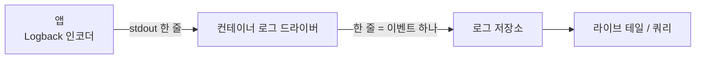

# 2026-10-13

**요약**: 배포 환경 JSON 로그의 필드 순서를 라이브 테일에서 읽히게 바꾸면서, "형태만 바뀌고 데이터는 그대로"를 실제 로그로 증명하는 검증 절차를 만들었다. 운영 로그를 이벤트로 되살려 이전·새 인코더에 같이 넣는 재현 비교로 약 1만 4천 줄이 값 동일함을 확인했고, 그 과정에서 첫 구현이 Spring 로그의 `tags` 필드를 빠뜨린 걸 잡았다.

## 배경과 제약
로그는 Logback + logstash-logback-encoder 의 `LogstashEncoder` 로 한 줄 JSON 을 stdout 에 쓰고, 컨테이너 로그 드라이버가 CloudWatch 로 보낸다. 줄 앞이 `@timestamp`·`@version`·`message`·`logger_name`·`thread_name` 으로 채워져 레벨과 경로가 뒤에 묻혔다. 요청은 `[api]:[level]:[message]` 평문이었지만, 평문은 스택트레이스가 줄마다 별도 이벤트로 쪼개지고 Logs Insights 의 자동 필드 인식을 잃어서 JSON 을 유지하고 **순서만** 바꾸기로 했다. 필드 이름은 기존 쿼리 때문에 건드리지 않는다.

## 흐름
로그가 화면에 닿는 길. 인코더가 쓴 문자열이 가공 없이 그대로 간다는 게 검증의 전제다.



검증은 네 단계로 했다. 앞 단계가 다음 단계의 전제를 만든다.

```pseudo
1. 로컬 실측:
   # 프로필은 local 유지 (아니면 알림이 실제로 나감)
   설정 파일만 바꿔 끼워 배포용 JSON 블록을 켬
   정상·에러 10종 요청 → 출력 순서 확인

2. 배포 설정 확인 (읽기 전용 계정):
   실제 등록된 태스크 정의의 프로필·환경변수·실행 인자 확인
   # ← 레포의 json 이 아니라 지금 돌고 있는 정의를 봐야 함
   빠지는 필드를 쓰는 메트릭 필터·구독·저장 쿼리·알람 조회

3. 실제 로그 재현 비교:
   for 줄 in 세 환경의 실제 로그 (ERROR·WARN·tags·stack_trace 따로 더 모음):
       이벤트 = 되살리기(로거, 레벨, 메시지, 스레드, 나노초 시각, MDC, 마커)
       이전 = 이전 인코더(이벤트)
       # ← 복원 정확도: 여기가 같아야 아래 비교를 믿을 수 있음
       assert 이전 == 줄
       새 = 새 인코더(이벤트)
       assert 새 == 이전 - {@version, level_value}

4. 되살릴 수 없는 것 따로:
   같은 예외(단일·원인 체인·suppressed·깊은 스택)를 두 인코더에 → stack_trace 문자열 비교
```

인코더 설정은 `LogstashEncoder` 를 `LoggingEventCompositeJsonEncoder` 로 바꾸고 provider 를 원하는 순서로 나열했다. `level` → MDC 의 도메인·메서드·경로 → `message` → 나머지 MDC → 스택 → 로거·스레드 → `@timestamp` 순서다.

## 막혔던 것
- **MDC 를 한 묶음으로 넣으면 순서가 안 지켜졌다.** `includeMdcKeyName` 을 domain·httpMethod·path 순으로 적었는데 path → httpMethod → domain 으로 찍혔다. Logback MDC 가 HashMap 이라 키 필터는 고를 키만 거르고 순서는 해시 순서를 따른다. 키마다 `<mdc>` provider 를 따로 둬서 고정했다.
- **"빠지는 건 두 필드뿐"이 틀렸다 — 틀렸던 가설.** 로컬에서 이전·새 출력의 키 목록을 비교해 `@version`·`level_value` 외 누락 없음으로 결론냈다. 비교에 쓴 이벤트에 마커가 붙은 로그가 없었다. dev 실제 로그로 배포 후 모습을 예상해 보다가 `"tags":["COMMONS-LOGGING"]`(Spring 이 commons-logging 경유로 남기는 로그의 마커)가 새 설정에서 사라지는 걸 봤다. dev 에선 182줄 중 100줄에 붙어 있었다. `LogstashEncoder` 가 기본으로 켜 두던 tags·Logstash marker·key-value·StructuredArguments provider 를 넣어 복원했다. 키 목록 비교가 아니라 **실제 로그 전체를 재현 비교**하는 3단계를 만든 계기다.
- **IDE 실행 인자가 안 먹었다.** Program arguments 에 넣은 `--logging.config` 가 실제 프로세스 인자에 없었다. `ps` 로 확인한 뒤 프로필별 properties 에 임시 한 줄을 넣는 쪽으로 바꿨고, 확인 후 지웠다.
- **충돌 검사 오탐.** `git diff --name-only HEAD..origin/develop` 에 내 파일이 잡혀 develop 도 같은 파일을 바꾼 줄 알았다. 그 diff 는 내 변경 자체를 보여준 것이었다. `git log HEAD..origin/develop -- <파일>` 와 `git merge-tree --write-tree` 로 다시 봐야 했다.

## 결과와 대가
| 환경 | 줄 | 이전 인코더 = 실제 로그 | 새 인코더 값 동일 |
|---|---|---|---|
| dev | 182 | 182 | 182 |
| staging | 1,675 | 1,675 | 1,675 |
| prod | 12,100 | 12,100 | 12,100 |

필드별 값 차이 0건, `stack_trace` 4/4 글자 단위 동일. 문자열로는 다른 줄이 1,477줄 있었는데 전부 MDC 키 사이 순서 차이(해시 순서)였고 값은 같았다. 대가는 `@version`·`level_value` 두 필드가 빠지는 것뿐이고, 둘을 쓰는 필터·쿼리·알람이 없는 것도 확인했다.

## 남은 것
배포 후 라이브 테일 실제 화면 확인. 블루/그린 전환 중엔 두 형식이 잠시 섞인다.

태그: #logging #logback #json-logging #verification #replay-test
