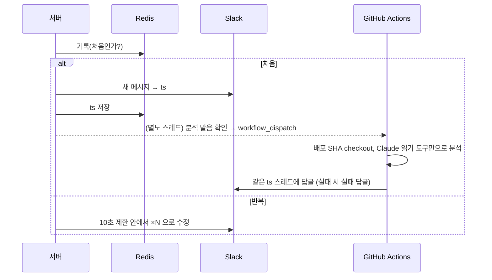

# 2026-10-14

**요약**: 서버 에러 Slack 알림을 "같은 에러끼리 메시지 하나 + ×N회"로 묶고, 새 에러마다 Claude 가 배포된 커밋의 코드를 읽어 원인을 추정해 같은 스레드에 답글을 달게 했다. 서버는 판단과 실행 요청만 하고 분석은 GitHub Actions 에 맡겼다. staging 에서 에러 발생 50초 뒤 근거 줄 링크가 달린 답글이 자동으로 달렸고, 1회 약 $0.19 였다.

## 배경과 제약
기존 알림은 "마지막 에러 10분 안이면 한 스레드"라서 서로 다른 에러가 섞였다. 알림 속도가 중요해서 로그 수집기를 거치는 안(30초~2분 지연, 메시지 수정·스레드 답글 불가)은 버렸다. 서버는 ECS 다중 태스크라 묶음 상태는 Redis 에 둬야 했고, Redis 가 죽으면 기존 방식으로 바로 보내야 했다.

## 선택
| 문제 | 고른 것 | 버린 것 · 이유 |
|---|---|---|
| 같은 에러 판정 | 원인 예외 클래스 + 앱 프레임 2개 + 숫자·따옴표 값을 지운 메시지 → 해시 | 줄 번호 포함 — 코드가 조금만 바뀌어도 다른 에러가 됨 |
| 동시 기록 | Redis Lua 한 번(INCR·SETNX·EXPIRE) | 여러 명령 — 동시에 오면 "처음"이 둘 |
| 횟수 갱신 | 에러당 10초 1회 + 건너뛴 건 10초 뒤 최신값으로 한 번 더 | 매번 갱신 — Slack 수정 API 분당 한도를 에러 종류들이 나눠 씀 |
| 분석 실행 위치 | 서버는 판단 후 workflow_dispatch, Actions 가 배포 SHA checkout 후 분석 | 서버에서 API 직접 호출 — 컨테이너에 소스가 없고, 분석이 수십 초 걸림 |
| 재분석 | 같은 에러 + 같은 SHA 는 24시간 1회, 하루 상한 20회 | 1시간마다 — 같은 에러로 하루 24번 호출 가능 |
| 보내는 정보 | 파라미터는 이름만, 예외 메시지는 값 마스킹, 요청자는 종류만 | 값 포함 — 워크플로 입력은 레포 읽기 권한자 누구나 실행 화면에서 봄 |

## 흐름

## 막혔던 것
- **"main 에 있어야 실행된다"고 단정했다가 틀렸다.** workflow_dispatch 는 기본 브랜치에 파일이 있어야 받는데, 이 레포 기본 브랜치는 main 이 아니라 develop 이었다. develop 머지 순간 등록됐다. 추측 말고 레포 설정부터 봤어야 했다.
- Claude 단계가 0.2초·비용 0 으로 실패. 모델 바꿔도 같아서 키를 직접 호출해 보니 `not scoped to a workspace`. 사용자 단위 키를 "조직" 범위로 만들면 워크스페이스 헤더가 필요했다. "워크스페이스" 범위로 다시 만들어 해결.
- 서버 호출이 404. GitHub 은 토큰이 레포를 못 볼 때 403 대신 404 를 준다. fine-grained PAT 가 조직 승인 대기 상태였다.
- 테스트용 500 을 고르면서 `Page index` 에러를 썼는데 알림이 안 왔다. 기존 노이즈 무시 목록에 있었다. `Page size` 에러로 바꿔 확인.

## 결과와 대가
- staging: 서로 다른 에러 3종을 4번씩 섞어 동시에 보내도 메시지가 정확히 갈라지고 횟수가 맞았다(×4·×5·×8).
- 에러 → 알림 2초 → Actions 실행 4초 → 답글 약 50초. 답글이 37줄의 `page` 보정과 비교해 `size` 만 보정이 빠졌다는 걸 짚었다. Opus 3턴 약 $0.19.
- 대가: 키·토큰이 개인 계정에 묶였다. 만료나 퇴사 때 조용히 멈춘다.

## 남은 것
- 운영 환경 토큰 등록, 키 만료일 관리
- 마스킹은 모양 기반이라 따옴표 없이 붙은 이름은 못 잡는다. 근본은 예외·로그를 만드는 쪽에서 막기
- 인프라 장애 분류·폭주 묶음, 로그 첨부는 답글 품질을 보고

태그: #slack #alerting #redis #lua #github-actions #claude #error-tracking #fingerprint #rate-limit #prompt-injection
