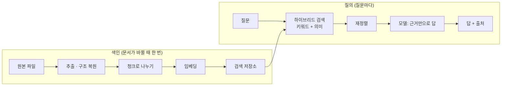

# 2026-10-20

**요약**: AI 강의 2회차 주제는 RAG(문서에서 관련 부분을 먼저 찾아 근거로 답하게 하는 방식)였다. 실습에서 챗봇을 만들고 질문 3개짜리 골든셋으로 반복 채점까지 했다. 남은 결론은 두 가지다. 내 코드 탐색에는 지금 쓰는 에이전트 검색이 맞고, RAG가 필요한 곳은 "쓴 사람과 찾는 사람이 다른 문서"다. 어떤 도구를 쓰든 정답이 붙은 질문 모음부터 만들어야 한다.

## 배경과 제약

1회차(10-13)는 마크다운 파일 몇 개를 AI에게 통째로 읽혔다. 2회차는 형식이 제각각인 문서(PDF·한글·엑셀·스캔본)를 AI가 읽을 수 있게 바꾸고, 질문과 관련된 조각만 찾아 근거로 답하게 하는 흐름이었다. 이 전체를 사내망 안의 로컬 모델로 돌린다는 전제가 붙었다. 로컬 모델은 작아서 한 번에 읽는 양이 적으니, 필요한 부분만 골라 주는 검색이 사실상 필수가 된다.

## 흐름

검색이 품질의 대부분을 정한다. 앞에서 엉뚱한 조각을 넘기면 모델이 아무리 좋아도 틀린다.

## 붙잡고 본 질문

- **"파일을 그냥 AI한테 읽히면 되지 않나?"** 반만 맞다. 어느 파일인지 알고 개수가 적으면 통째로 읽히는 게 더 간단하고 정확하다. RAG의 가장 큰 가치는 규모가 아니라 **답이 어느 파일에 있는지 몰라도 찾아 준다**는 점이었다. 그래서 키워드가 정확한 코드 탐색은 지금처럼 에이전트가 grep으로 뒤지는 게 맞고, RAG가 필요한 곳은 운영·CS·기획이 "이 규정 뭐였지?"를 문서 작성자에게 묻는 상황이다.
- **"벡터 DB가 곧 RAG인가?"** 아니다. 벡터 검색은 찾는 방법 중 하나일 뿐이다. 판단 순서는 파일을 아는가 → 정확한 단어를 아는가 → 표현이 달라도 찾아야 하는가 → 문서가 많은가이고, 앞에서 해결되면 벡터 DB를 들이지 않는다. 실무에서는 키워드(BM25)와 의미 검색을 섞는데, 점수 범위가 달라 그냥 더하면 키워드 쪽이 압도한다. 순위만 쓰는 RRF로 시작하고, 평가 데이터가 쌓이면 비율을 대상별로 조정한다.
- **"전부 몇 건이야?"도 RAG로 되나?** 안 된다. top-k가 50이면 51번째부터는 모델이 아예 못 본다. 그러니 집계 질문에 틀린 숫자를 자신 있게 말한다. 계산도 마찬가지로 약하다. 질문 성격에 따라 검색은 RAG로, 집계는 DB 조회로, 계산은 코드 실행으로 나눠 보내야 한다.
- **"스캔본은 VLM이면 되나?"** VLM은 표·다단 구조를 잘 읽는다. 대신 없는 숫자를 그럴듯하게 지어낼 수 있고, 틀려도 자연스러워서 눈에 안 띈다. OCR은 틀리면 글자가 깨져 보인다. 표 안의 숫자는 어느 쪽을 쓰든 원문과 대조해야 한다.

## 실습 — 골든셋으로 반복 채점

챗봇 만들기 9단계(추출 → 정리 → 청크 → 근거 검색 → 답변 대조 → 문서 수정 → 게시 → 자동 평가)의 마지막이 자동 평가였다. 질문 3개에 원문 기준 정답·근거를 붙인다.

| 질문 | 확인하는 것 |
|---|---|
| 문서에 답이 있는 질문 | 찾아서 맞게 답하는가 |
| 표현을 바꾼 질문 | 같은 뜻을 다른 말로 물어도 찾는가 |
| 문서에 없는 질문 | 지어내지 않고 "확인할 수 없음"이라고 하는가 |

서버가 답을 만들고 정답과 비교해 통과·실패를 판정한다(LLM-as-a-judge). 사람이 판정 이유를 원문과 대조해 「확인 완료」를 누르면 그 실행이 기준이 된다. 문서나 검색 설정을 바꾸고 다시 돌리면 「새로 실패한 질문」이 따로 표시된다. 이게 회귀 테스트다. 1회차 실습 키트의 채점 스크립트(62/62)와 같은 발상이다. 기준 답을 먼저 두고, 바꿀 때마다 돌린다.

## 남은 것

- 우리 쪽 첫 후보는 공고 문서(hwp·PDF)와 기능 정책 문서다. 시작은 도구 선택이 아니라 골든셋이다. 운영·CS가 실제로 물어본 질문 수십 개와 정답 조항을 먼저 모아 두면 어떤 도구든 같은 기준으로 비교할 수 있다.
- 이 강의의 "추출" 단계는 11-01에 만든 학생 과제(공고 hwp를 읽어 입력 폼을 채우는 것)로 이어졌다.

태그: #rag #hybrid-search #golden-set #evaluation #ocr #vlm #ai-lecture
