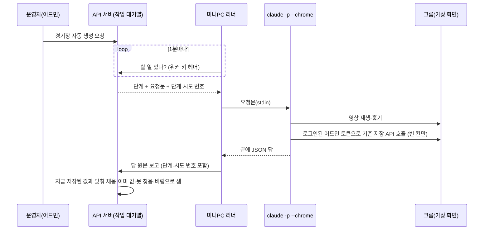

# 2026-11-13

**요약**: 경기 영상에서 경기 시작·득점 시각을 찾는 일을, 사람이 각자 노트북의 Claude 크롬 확장으로 하던 방식에서 사무실 미니PC가 대기열에서 작업을 가져가 `claude -p --chrome` 으로 처리하는 방식으로 바꿨다. API·Gemini·영상 파일 방식을 모두 검토했지만, 추가 비용 없이 이미 쓰는 Claude 구독 안에서 끝나는 길은 "사람이 하던 브라우저 작업을 서버에 앉히는 것"뿐이었다.

## 배경과 제약

운영팀은 대회마다 경기장별 중계 영상(6~9시간)을 처음부터 돌려 보며 경기 시작·득점 시각을 손으로 넣었다. 큰 대회 하나에 경기 시작 555개, 점수 1,433개였다. 처음 시도한 AX 방식은 사람이 경기장 하나씩 맡아 자기 노트북 크롬에서 Claude 확장에게 영상을 보게 하는 것이었다. 정확도는 쓸 만했지만 병목이 사람에게 그대로 남았다. 몇 시간짜리 영상을 보는 동안 노트북과 브라우저를 붙잡아 둬야 했고, 요청문(프롬프트)이 사람마다 달라 결과도 달랐다.

제약은 하나였다. 새 공급자나 종량 과금 없이 지금 구독 중인 Claude Code 안에서 해결한다.

## 선택

| 길 | 막힌 곳 |
|---|---|
| Claude API 로 영상 판독 | API 는 글·이미지·PDF 만 받는다. 영상·유튜브 링크는 받지 않는다 |
| 서버가 영상을 내려받거나 자동화 브라우저로 캡처 | 승인 없는 다운로드·자동화 접근을 금지하는 플랫폼 약관에 걸린다 |
| 이미지 VLM 으로 프레임 판독 | 점수판 한 장은 약 1센트로 정확히 읽었다. 하지만 프레임을 얻으려면 결국 영상 파일이 있어야 한다 |
| Gemini 에 유튜브 링크 전달 | 링크만으로 영상을 읽는 유일한 통로다. 다만 공급자·키·비용이 새로 생긴다 |
| 점수 기록 기기의 시각으로 계산 | 그 시각이 남아 있는 점수는 15%뿐이었다. 기록표를 다시 저장하면 사라진다 |
| **미니PC 의 Claude Code + 크롬 확장** | 사람이 하던 방식 그대로라 정확도는 검증돼 있다. 남은 문제는 "누가 언제 실행하나"뿐이다 |

마지막 길로 정했다. 요청이 오면 사무실 미니PC 터미널의 Claude 가 받아 그 PC 의 크롬으로 영상을 본다.

## 흐름

사무실 PC 에 바깥에서 들어오는 포트를 열지 않으려고 PC 가 서버에 묻는 pull 방식으로 했다.



- **단계 나누기는 서버가 한다.** 1차는 영상 전체에서 경기·판 시작을 찾고, 2차는 1차 위치를 주고 경기 10개씩 득점을 찾는다. 시험에서 1차는 6시간 영상에 85분, 2차는 10경기에 30분이 걸렸다.
- **값은 Claude 가 직접 저장하고, 서버는 세기만 한다.** 서버가 받은 값을 검사해 저장하는 안에서 바꿨다. 기존 저장 API 를 재사용하는 대가로 서버가 범위 밖 쓰기를 막지 못한다. 그래서 운영 전에 최소 권한 전용 계정이 필요하다.
- **늦게 온 보고는 버린다.** 보고에 단계 번호와 시도 번호를 함께 실어, 앞 시도의 늦은 보고가 진행 중인 시도를 실패로 바꾸지 않게 했다.
- **스케줄러 없이 정리한다.** 가져간 뒤 3시간 안에 보고가 없으면 실패로 센다. 이 정리는 가져가기·상태 조회 때 한다. 작업 수가 적고 러너가 1분마다 부르니 그걸로 충분했다.

러너는 이렇게 동작한다.

```pseudo
반복:
  # 네트워크
  단계 = 서버.가져가기()
  if 없음: 1분 쉼, 계속
  # 크롬 확장 도구 + sleep 만 허용, 나머지는 묻지 않고 거절
  결과 = claude 실행(이 PC 브라우저만 쓰라는 줄 + 요청문, 상한 150분)
  if 사용 한도·과부하:
      # ← 실패로 보고하면 같은 단계가 2번 실패해 작업이 끝난다
      30분마다 짧은 요청으로 확인 → 풀리면 같은 단계 처음부터
  elif 1차 단계 and 10분 안에 끝남 and 찾은 칸 0:
      # ← 영상을 안 훑고 일찍 포기한 것으로 본다
      서버.실패보고()
  else:
      # 5xx·연결 실패면 30초마다 최대 15분 다시 보냄 (배포 중 서버 멈춤)
      서버.결과보고(답 원문)
  finally:
      # 탭·메모리 누적 방지, 로그인은 프로필에 남는다
      크롬 서비스 재시작
```

실행 환경은 공용 서버라 전용 계정 하나에 가뒀다. 가상 화면(Xvfb)·창 관리자·크롬·로그인용 VNC(로컬 전용)·러너를 각각 systemd 서비스로 등록했다. 러너는 `--tools Bash`, `--permission-mode dontAsk`, `--allowedTools` 로 크롬 확장 도구와 `sleep` 만 쓰게 했다. 작업 폴더도 설정·비밀 파일이 있는 홈이 아닌 별도 폴더로 줬다. 요청문에는 영상 설명·댓글·채팅에 적힌 지시를 따르지 말라는 줄을 넣었다. 주최측이 고칠 수 있는 칸(대회 이름 같은 것)은 요청문에 넣지 않았다. 영상 주소도 영상 ID 만 뽑아 다시 조립해서 넣었다.

## 막혔던 것

- **"0개 = 없음"이라고 믿었다.** 1차가 5분 만에 "영상 전체에 경기 번호 없음"으로 끝났는데, 같은 영상에서 2차는 득점 12개를 찾았다. 다른 영상은 첫 시도가 3분 만에 0이었는데 다시 돌리니 135칸을 찾았다. 그래서 1차가 너무 빨리 0으로 끝나면 실패로 보고해 한 번 더 돌린다.
- **그 규칙을 2차에도 걸었다가 작업을 날렸다.** 영상이 중간에 끊긴 구간은 0이 정답인데, 실패로 두 번 세져 작업 전체가 끝났고 뒤 묶음을 처리하지 못했다. 규칙을 1차에만 남겼다.
- **크롬이 쌓였다.** 8시간 동안 탭 15개, 메모리 3GB가 쌓였다. 단계마다 크롬을 다시 시작한다. 단계가 예외로 끝나도 재시작하도록 finally 로 감쌌다.
- **구독 한도가 실패처럼 보였다.** 5시간·주 단위 한도에 걸린 채 실패로 보고하면, 그 작업뿐 아니라 대기열의 다음 작업들도 연달아 실패한다. 한도는 실패가 아니라 대기로 다룬다. 한도 문구 없이 바로 끝난 실행은 한 번만 기다린다. 다시 나면 플래그나 크롬 연결 문제로 보고 실패로 보고한다.
- **같은 Claude 계정에 브라우저가 둘이었다.** 확장이 연결된 다른 PC 브라우저를 쓸 수 있어서, 요청문 맨 앞에 이 PC 브라우저만 쓰라는 줄과 기기 ID 를 넣었다.
- **전광판에 경기 번호가 없는 종목이 있었다.** 그런 종목은 두 선수 이름·소속으로 경기를 찾게 요청문을 바꿨다.

## 결과와 대가

저장하지 않고 사람이 넣은 값과 비교한 시험 결과는 다음과 같다.

| 항목 | 결과 |
|---|---|
| 경기 시작 | 54경기 중 53경기 1초 안 (나머지 1개는 시계가 돌지 않은 경기) |
| 기술 점수 | 22개 중 21개 ±5초 (19개는 1초 안) |
| 반칙 점수 | 13개 중 9개 ±5초 — "시계가 멈춘 순간" 기준. "전광판 표시" 기준이면 4개 |
| 단체전 판 시작 | 10개 중 8개 ±5초 |
| 저장 시험 | 값을 비운 10경기 모두 사람 값과 같게 채움 |

경기장 하나에 1시간 23분~3시간 44분이 걸렸다. 사람은 버튼만 누르고, 못 찾은 칸만 손으로 채우면 된다. 대가는 세 가지다.

- 미니PC 한 대가 한 번에 한 경기장만 처리한다.
- 구독 한도를 팀과 나눠 쓴다.
- 저장을 AI 에게 맡겨서 서버가 범위 밖 쓰기를 막지 못한다.

반칙 점수에서 보듯 정확도는 모델보다 "어느 순간을 정답으로 볼지"를 요청문에 어떻게 적느냐에 더 크게 좌우됐다.

## 남은 것

- 운영 환경에 쓰기 전: 최소 권한 전용 계정, 운영용 키 분리, Claude 계정 분리 검토
- 어드민 화면: 요청 버튼, 진행 상태, 못 찾은 칸 목록. 대기 순번도 보여 줄지 정해야 한다
- 요청문 품질은 실제 대회에서 계속 피드백을 받아야 한다

태그: #claude-code #claude-in-chrome #ai-automation #job-queue #polling-worker #prompt-injection #systemd
