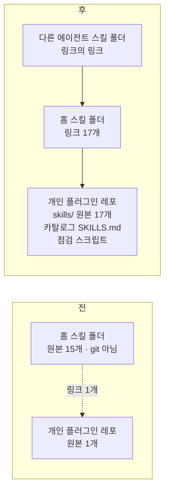

# 2026-11-18

**요약**: 다섯 군데에 흩어져 있던 개인 Claude 스킬 17개의 원본을 개인 플러그인 레포 한 곳으로 모으고, `~/.claude/skills` 에는 그 레포를 가리키는 링크만 남겼다. 스킬 전체를 세 갈래로 나눈 카탈로그 한 파일과, 카탈로그와 실제 폴더가 어긋나는지 출력하는 점검 스크립트를 같은 레포에 두었다.

## 배경과 제약

회의 결정을 기록하는 스킬을 새로 만들다가, 내 스킬이 어디에 몇 개 있는지 한눈에 보이지 않는다는 걸 알았다. 원본이 있는 곳이 다섯 군데였다.

- 홈 스킬 폴더(`~/.claude/skills`) — 개인 스킬 15개. git 이 아니라 이력도 백업도 없다
- 개인 플러그인 레포 — 브리핑 스킬 1개. 홈 스킬 폴더에는 링크만 있다
- 업무 레포의 프로젝트 스킬 · 명령어, 팀 공용 플러그인, 외부 CLI 가 깔아 둔 스킬 링크

홈 스킬 폴더의 15개는 다른 맥에서 쓰려면 손으로 복사해야 했다. 매일 아침 클라우드에서 도는 브리핑 루틴은 레포만 체크아웃하므로, 레포 밖에 있는 스킬은 그 루틴에서 아예 보이지 않았다.

제약은 경로였다. Claude Code 는 `~/.claude/skills/<이름>/SKILL.md` 에서 스킬을 찾고, 스킬 안 설명에도 이 경로로 스크립트를 부르는 곳이 있다(녹음 전사 스크립트 등). 이 경로는 바뀌면 안 된다.

## 선택

| 방법 | 좋은 점 | 걸린 점 |
|---|---|---|
| 그대로 두고 카탈로그만 만든다 | 바뀌는 게 거의 없다 | 원본이 git 밖이라 이력 · 백업 · 다른 맥 재현이 그대로 안 된다 |
| 홈 스킬 폴더 자체를 git 레포로 만든다 | 경로를 건드리지 않는다 | 외부 CLI 링크와 앱 동기화 폴더까지 한 레포에 섞인다 |
| **개인 플러그인 레포로 옮기고 원래 자리에 링크** | 이력 · 백업 · clone 한 번으로 재현, 클라우드 루틴도 같은 원본을 본다 | 레포가 비공개 개인용이라 팀 공유는 따로 해야 한다 |

브리핑 스킬 하나가 이미 「레포 원본 + 홈 폴더 링크」 방식으로 잘 돌고 있어서, 그 방식을 나머지에 넓혔다. 처음에는 카탈로그와 새 스킬만 레포에 넣고 기존 15개 이동은 승인을 기다렸는데, 그 상태는 「카탈로그는 레포에, 원본 대부분은 레포 밖에」 있는 반쪽이라 결국 전부 옮겼다.

## 관리 구조



카탈로그는 내가 쓰는 스킬 전체(레포 밖 것 포함)를 한 표로 둔다.

- 분류 세 갈래: **개발 · 리뷰** / **운영 · 보고** / **기타 · 도구**
- 칸: 위치(개인 레포 · 업무 레포 · 팀 플러그인 · 외부 CLI), 개인 정보가 든 파일 수(내 메신저 ID · 이름을 grep 한 결과), 하는 일 한 줄
- 개인 정보 칸은 「이 스킬을 남에게 줄 수 있나」를 바로 보려고 둔 것이다. 0이 아니면 그 값을 설정으로 빼야 공유할 수 있다

점검 스크립트는 표와 디스크를 맞춰 보기만 한다.

```pseudo
점검():
  목록 = 카탈로그 표 첫 칸의 스킬 이름들
  실제 = 홈 스킬 폴더(링크 포함) + 업무 레포 스킬 · 명령어 + 팀 플러그인 스킬
  # 앱이 동기화하는 폴더는 관리 대상이 아니다
  실제에서 앱 동기화 폴더 제외
  # 카탈로그에 빠진 스킬
  출력(실제 - 목록)
  # 지워졌는데 카탈로그에 남은 스킬
  출력(목록 - 실제)
  # ← 아무것도 고치지 않는다. 표는 사람이 고친다
```

## 흐름

1. 옮기기 전 점검 — 링크가 아닌 실제 폴더인지, 레포에 같은 이름이 없는지, 200KB 넘는 파일이나 토큰처럼 보이는 문자열이 없는지
2. 폴더마다 `mv` 로 레포에 옮기고 원래 자리에 `ln -s` → 링크 경로로 `SKILL.md` 가 열리는지 확인
3. 점검 스크립트 결과 0 / 0, 전사 스크립트를 원래 경로로 부를 수 있는지 확인, 다른 에이전트용 동기화 스크립트 다시 실행
4. 클라우드 루틴이 먼저 올린 커밋을 fast-forward 로 받고, 「스킬 이동」과 「새 스킬 + 카탈로그」 두 커밋으로 나눠 push

## 막혔던 것

다른 에이전트(Codex)용 동기화 스크립트를 다시 돌리자, 「Claude 가 Codex CLI 를 불러 교차 리뷰하는」 스킬까지 Codex 쪽에 연결됐다. Codex 안에서는 쓸 일이 없는 스킬이다. 링크만 지우면 다음 실행 때 스크립트가 다시 만들기 때문에, 스크립트에 이 스킬을 건너뛰는 예외를 넣었다. 「전부 연결」 규칙은 예외 목록과 같이 있어야 한다.

## 결과와 대가

- 개인 스킬 17개의 원본이 레포 한 곳에 모였고, 홈 스킬 폴더에는 링크만 남았다. 카탈로그 ↔ 디스크 어긋남 0건
- 다른 맥에서는 clone 한 뒤 `skills/*` 를 홈 스킬 폴더에 링크하는 한 줄로 같은 상태가 된다
- 대가: 레포가 비공개 개인용이라 팀 공유는 여기서 끝나지 않는다. 17개 중 6개는 내 메신저 ID · 이름이 들어 있어 공유 전에 설정으로 빼야 한다

## 남은 것

- 팀과 나눌 스킬은 팀 공용 플러그인으로 올린다. 개인 정보 분리가 먼저다
- 새 스킬을 만들 때 순서: 레포에 만들기 → 링크 → 카탈로그 한 줄 → 점검 스크립트

태그: #claude-code #agent-skills #symlink #dotfiles #tooling
